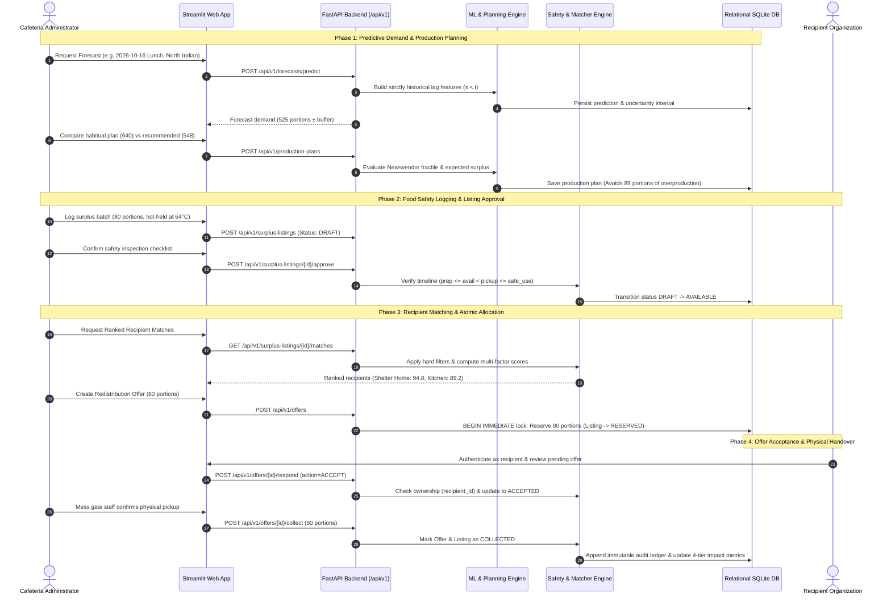

# AI-Powered Food Waste Prediction & Redistribution Intelligence

[](https://www.python.org/downloads/)
[](https://fastapi.tiangolo.com/)
[](https://streamlit.io/)
[](https://scikit-learn.org/)
[](LICENSE)
[](docker-compose.yml)

> **ORIGIN MINI 2026 — Problem Statement 04**  
> **School of Computer Science & Engineering (SCSE), Galgotias University**  
> *An End-to-End Decision-Support Platform for Cafeteria Demand Forecasting, Quantile Production Planning, Food Safety Governance, and Algorithmic Recipient Redistribution.*

---

## Table of Contents

1. [Executive Summary](#executive-summary)
2. [Dual-Pillar Core Architecture](#dual-pillar-core-architecture)
3. [System Architecture & Interaction Flow](#system-architecture--interaction-flow)
4. [Key Features & Technical Highlights](#key-features--technical-highlights)
5. [Mathematical & Algorithmic Foundations](#mathematical--algorithmic-foundations)
6. [Interactive Streamlit Modules](#interactive-streamlit-modules)
7. [Pre-Seeded Demo Accounts & RBAC](#pre-seeded-demo-accounts--rbac)
8. [REST API Reference](#rest-api-reference)
9. [Repository Layout](#repository-layout)
10. [Quickstart & Installation Guide](#quickstart--installation-guide)
11. [Running with Docker & Docker Compose](#running-with-docker--docker-compose)
12. [Automated Verification & Test Suite](#automated-verification--test-suite)
13. [Data Provenance & Synthetic Generator](#data-provenance--synthetic-generator)
14. [Security, Concurrency & Production Hardening](#security-concurrency--production-hardening)

---

## Executive Summary

Large-scale institutional cafeterias (such as university mess facilities and corporate dining halls) routinely face severe food waste challenges driven by two compounding inefficiencies:

1. **Pre-Consumer Overproduction at the Source:** Dining demand fluctuates dramatically based on calendar days, semester schedules, exam periods, campus fests, menu selections, and ambient weather. Without data-driven predictions, kitchens over-prepare meals by 15–25% to avoid running out, generating chronic edible surplus.
2. **Post-Consumer Redistribution Friction:** When unserved surplus does occur, it is frequently discarded rather than donated due to an absence of food safety verification, lack of real-time shelf-life tracking, and manual coordination delays with local charities.

This platform provides an end-to-end, mathematically rigorous operational system designed to eliminate cafeteria food waste through **source reduction** and **safe, automated redistribution**.

```
                           ┌────────────────────────────────────────┐
                           │   Institutional Cafeteria Operations   │
                           └──────────────────┬─────────────────────┘
                                              │
                      ┌───────────────────────┴───────────────────────┐
                      ▼                                               ▼
         [PILLAR 1: SOURCE REDUCTION]                   [PILLAR 2: SURPLUS RECOVERY]
    Chronological ML Demand Forecasting             Food Safety State Machine
                      │                                               │
    Quantile Production Planning Policy             Explainable Recipient Matcher
                      │                                               │
         Minimizes Overproduction                        Atomic Reservation & Handover
                      │                                               │
                      └───────────────────────┬───────────────────────┘
                                              ▼
                             ┌─────────────────────────────────┐
                             │  4-Tier Auditable Impact Ledger │
                             │  (CO2e, Water, Cost, Portions)  │
                             └─────────────────────────────────┘
```

---

## Dual-Pillar Core Architecture

### Pillar 1: Source Reduction (Predictive Forecasting & Planning)
- **Chronological Time-Series Machine Learning:** Uses `HistGradientBoostingRegressor` (with numpy/scikit fallback) evaluated on held-out chronological splits, achieving **19.90 portions MAE (4.54% WAPE)** vs. **49.02 portions MAE (11.18% WAPE)** for the Seasonal Moving Average baseline — a **59.4% error reduction**.
- **Right-Censored Demand Detection:** Automatically corrects observed consumption when kitchens experience stockouts ($D_{\text{effective}} = \text{served} + \text{unmet}$).
- **Newsvendor Critical Fractile Planning:** Blends kitchen shortage tolerance $\alpha$ with asymmetric economic penalties to output integer production targets with quantified safety buffers.

### Pillar 2: Surplus Recovery (Safety State Machine & Matcher)
- **7-State Food Safety Lifecycle:** Enforces a verifiable state machine:  
  `DRAFT` $\rightarrow$ `AVAILABLE` $\rightarrow$ `PARTIALLY_RESERVED` $\rightarrow$ `RESERVED` $\rightarrow$ `COLLECTED` (with `EXPIRED` and `CANCELLED` handlers).
- **Physical Timeline & Human-in-the-Loop Safety:** Requires temperature logging (hot-hold $\ge 60^\circ\text{C}$, cold-hold $\le 5^\circ\text{C}$) and human supervisor authorization before any listing becomes discoverable.
- **Explainable Recipient Matching:** Filters hard constraints (dietary categories, active status, verification, capacity, $\ge 30\text{ min}$ pickup overlap) and ranks recipients via a normalized multi-criteria scoring algorithm.
- **Atomic Concurrency Protection:** Employs SQLite `BEGIN IMMEDIATE` write locks to eliminate double-booking or over-allocation race conditions during high-volume reservation requests.

---

## System Architecture & Interaction Flow

The solution follows a 9-layer decoupled architecture:



---

## Key Features & Technical Highlights

| Capability | Technical Implementation | Operational Benefit |
| :--- | :--- | :--- |
| **Leak-Free ML Forecasting** | Chronological feature engineering where row $t$ only accesses records with $\text{service\_date} < t$. Auto-tested against target mutation. | Eliminates lookahead bias; real-world accuracy on future unseen dates. |
| **Cold-Start Fallback** | Automatic fallback to `SeasonalMovingAverageBaseline` when $< 21$ historical records exist. | Robust operation during new semester or kitchen rollouts without crashes. |
| **Quantile Planning** | Newsvendor critical fractile combining shortage risk tolerance $\alpha$ with cost asymmetry. | Prevents blind mean-demand overproduction while keeping stockout risk within policy. |
| **Food Safety State Machine** | Strict transition enforcement (`DRAFT` $\rightarrow$ `AVAILABLE` $\rightarrow$ `RESERVED` $\rightarrow$ `COLLECTED`) with temperature criteria. | Guarantees regulatory compliance; prevents spoiled food distribution. |
| **Explainable Matching** | Multi-criteria scoring with transparent sub-factor breakdowns displayed directly in UI. | Administrators understand *why* a charity was recommended. |
| **Atomic Concurrency** | SQLite `BEGIN IMMEDIATE` transactions and process-level threading locks. | Prevents double-booking or over-allocation race conditions under concurrent load. |
| **4-Tier Auditable Metrics** | Strict visual and API separation of Predictions, Simulations, Actuals, and Derived Estimates. | Transparent metrics reporting with explicit denominators for audit compliance. |
| **Enterprise Security & RBAC** | PBKDF2-HMAC-SHA256 (200,000 rounds), signed Bearer tokens, safe CSV sanitization. | Defense-in-depth protection against SQLi, XSS, formula injection, and privilege escalation. |

---

## Mathematical & Algorithmic Foundations

### 1. Demand Censoring & Effective Demand
When kitchen stock runs out (`meals_served == meals_prepared`), observed sales underestimate diner appetite. The preprocessing pipeline calculates effective demand:
$$D_{\text{effective}} = \text{meals\_served} + \text{unmet\_demand\_portions}$$
If `unmet_demand_portions` is unlogged, the system flags the record as potentially right-censored and issues an operator advisory.

### 2. Leak-Free Feature Vector Construction
For target date $t$ and meal slot $m \in \{\text{breakfast}, \text{lunch}, \text{dinner}\}$:
- **Cyclical Encoding:** $\sin(2\pi \cdot \frac{\text{month}}{12})$, $\cos(2\pi \cdot \frac{\text{month}}{12})$, $\sin(2\pi \cdot \frac{\text{dow}}{7})$, $\cos(2\pi \cdot \frac{\text{dow}}{7})$
- **Operational Context:** One-hot/ordinal encodings of `menu_category`, `special_event`, `weather_condition`, ambient `temperature_c`.
- **Strictly Historical Lags:** `lag_1d_demand`, `lag_7d_demand`, `rolling_7d_mean`, `rolling_14d_mean`, `rolling_7d_std`, `same_weekday_4w_mean`.

### 3. Production Planning & Uncertainty Quantile Policy
Given predicted demand $\hat{\mu}$, residual standard deviation $\hat{\sigma}_{\text{residual}}$, shortage risk tolerance $\alpha$, preparation unit cost $c_{\text{unit}}$, and shortage penalty $c_{\text{shortage}}$:
$$F_{\text{target}} = 0.65(1 - \alpha) + 0.35\left(\frac{c_{\text{shortage}}}{c_{\text{shortage}} + c_{\text{unit}}}\right)$$
$$\text{safety\_buffer} = \lceil \Phi^{-1}(F_{\text{target}}) \cdot \hat{\sigma}_{\text{residual}} \rceil$$
$$Q_{\text{recommended}} = \min\left(Q_{\text{capacity}}, \lceil \hat{\mu} + \text{safety\_buffer} \rceil\right)$$

Expected surplus is evaluated analytically via the normal loss integral:
$$\mathbb{E}[\max(0, Q - D)] = (Q - \hat{\mu})\Phi(z) + \hat{\sigma}\phi(z) \quad \text{where } z = \frac{Q - \hat{\mu}}{\hat{\sigma}}$$

### 4. Recipient Ranking Composite Score
For each eligible recipient organization $i$:
$$\text{Score}_i = w_1 \cdot S_{\text{proximity}} + w_2 \cdot S_{\text{capacity}} + w_3 \cdot S_{\text{urgency}} + w_4 \cdot S_{\text{tier}}$$
- $S_{\text{proximity}} = \max\left(0, 1 - \frac{\text{distance\_km}}{25.0}\right)$ (Weight $w_1 = 0.30$)
- $S_{\text{capacity}} = \min\left(1.0, \frac{\text{recipient\_capacity}}{\text{offered\_portions}}\right)$ (Weight $w_2 = 0.25$)
- $S_{\text{urgency}} = 1.0 - \frac{\text{minutes\_until\_pickup\_deadline}}{\text{total\_shelf\_life\_minutes}}$ (Weight $w_3 = 0.25$)
- $S_{\text{tier}} = \text{Tier Score} \in [0.4, 1.0]$ based on historical reliability (Weight $w_4 = 0.20$)

---

## Interactive Streamlit Modules

The frontend is organized into 6 dedicated operational modules accessible from the sidebar:

```
app/
├── Home.py                       # Operational KPI overview & real-time inventory
└── pages/
    ├── 1_Demand_Forecasting.py    # Multi-model evaluation, feature importance & meal predictor
    ├── 2_Production_Planning.py   # Quantile buffer planner & overproduction risk simulator
    ├── 3_Food_Surplus.py          # Surplus registration, temperature log & safety sign-off
    ├── 4_Redistribution.py        # Explainable recipient matching, reservation & collection
    ├── 5_Analytics.py             # 4-tier auditable impact report (CO2e, Water, Portions, Ledger)
    └── 6_Data_Management.py       # Safe CSV validation, upload inspection & synthetic data tools
```

1. **Home (`Home.py`):** Live dashboard showing held-out model accuracy, simulated overproduction avoided, available surplus, and real-time inventory breakdown.
2. **Demand Forecasting (`1_Demand_Forecasting.py`):** Train and compare Baseline vs. GBRT models on held-out test splits. Generates point estimates, planning buffers, and contributing factors for upcoming meal slots.
3. **Production Planning (`2_Production_Planning.py`):** Compare the cafeteria's habitual plan against the Newsvendor recommendation. Quantifies overproduction avoided and shortage risk.
4. **Food Surplus (`3_Food_Surplus.py`):** Register new surplus batches with food category, storage condition, and temperatures. Human supervisor reviews and approves batches from `DRAFT` to `AVAILABLE`.
5. **Redistribution Intelligence (`4_Redistribution.py`):** Inspect eligible charities ranked with transparent sub-scores. Issue offers, reserve portions atomically, and confirm physical collections.
6. **Impact Analytics (`5_Analytics.py`):** Auditable 4-tier reporting panel (Predictions, Simulations, Actuals, Derived Estimates). Computes environmental impact ($2.5\text{ kg CO}_2\text{e}$ and $420\text{ L water}$ per portion) and exports an audit JSON report.
7. **Data Management (`6_Data_Management.py`):** Inspect historical meal records, generate synthetic datasets, or upload cafeteria CSVs with dry-run schema and anomaly validation.

---

## Pre-Seeded Demo Accounts & RBAC

The platform includes 4 pre-seeded demo personas with distinct role permissions. A quick-switcher in the Streamlit sidebar allows instant switching during live evaluations:

| Username | Password | Role | Organization / Identity | Permissions |
| :--- | :--- | :--- | :--- | :--- |
| `cafeteria_admin` | `OriginCafeteria#2026` | `cafeteria_admin` | Hostel Mess Administrator | Predict, plan, create/approve surplus, issue offers, confirm collections |
| `recipient_yamuna` | `OriginRecipient#2026` | `recipient_org` | Yamuna Expressway Shelter Home | View assigned offers, accept/decline offers, view own collection history |
| `recipient_gnckt` | `OriginRecipient#2026` | `recipient_org` | Greater Noida Community Kitchen | View assigned offers, accept/decline offers, view own collection history |
| `project_admin` | `OriginAdmin#2026` | `project_admin` | Project Lead / Evaluator | Full system administrative access, retrain models, inspect immutable audit events |

*Note: Passwords are encrypted using PBKDF2-HMAC-SHA256 with 200,000 iterations and unique 16-byte cryptographic salts. Plaintext passwords are never stored.*

---

## REST API Reference

The FastAPI backend exposes versioned endpoints under `/api/v1`. Interactive documentation is available at `http://127.0.0.1:8000/docs`.

### Authentication & System
| Method | Endpoint | Permission | Description |
| :--- | :--- | :--- | :--- |
| `GET` | `/api/v1/health` | Public | System status, record count, and active model version |
| `POST` | `/api/v1/auth/login` | Public | Authenticates credentials and returns signed Bearer token |
| `GET` | `/api/v1/auth/me` | Authenticated | Returns current authenticated profile and permissions |
| `GET` | `/api/v1/auth/demo-accounts` | Public | Returns pre-seeded demo accounts for evaluation |
| `GET` | `/api/v1/audit-events` | `audit:read` | Returns immutable system audit events |

### Historical Meals & Data Pipeline
| Method | Endpoint | Permission | Description |
| :--- | :--- | :--- | :--- |
| `GET` | `/api/v1/meals` | `meals:read` | Paginated query of historical meal records |
| `POST` | `/api/v1/meals` | `meals:write` | Inserts validated meal-service record (`409` on duplicate date+meal) |
| `PUT` | `/api/v1/meals/{record_id}` | `meals:write` | Updates prepared, served, and leftover quantities |
| `POST` | `/api/v1/meals/validate-csv` | `meals:write` | Dry-run validation check for uploaded CSV file |
| `POST` | `/api/v1/meals/import-csv` | `meals:write` | Validates and imports historical records from CSV |

### Forecasting & Planning
| Method | Endpoint | Permission | Description |
| :--- | :--- | :--- | :--- |
| `POST` | `/api/v1/models/train` | `models:train` | Retrains models on chronological splits and evaluates metrics |
| `GET` | `/api/v1/models/evaluations` | `forecasts:read` | Lists model runs, chronological splits, and feature importances |
| `POST` | `/api/v1/forecasts/predict` | `forecasts:write` | Generates demand forecast, planning buffer, and factor attribution |
| `GET` | `/api/v1/forecasts/history` | `forecasts:read` | Lists forecast history joined with actual observed demand |
| `POST` | `/api/v1/production-plans` | `plans:write` | Evaluates Newsvendor quantile plan and overproduction risk |
| `GET` | `/api/v1/production-plans` | `plans:read` | Lists historical production plans and post-service actuals |
| `PUT` | `/api/v1/production-plans/{id}/actuals` | `plans:write` | Records actual meal production, consumption, and leftovers |

### Surplus Management & Redistribution
| Method | Endpoint | Permission | Description |
| :--- | :--- | :--- | :--- |
| `GET` | `/api/v1/recipients` | `recipients:read` | Lists recipient directory with active/verified filters |
| `POST` | `/api/v1/recipients` | `recipients:write` | Registers a new recipient organization |
| `GET` | `/api/v1/surplus-listings` | `surplus:read` | Lists surplus listings filtered by status and category |
| `POST` | `/api/v1/surplus-listings` | `surplus:write` | Registers new surplus batch (starts in `DRAFT` status) |
| `POST` | `/api/v1/surplus-listings/{id}/approve` | `surplus:approve` | Supervisor confirms safety check; transitions to `AVAILABLE` |
| `GET` | `/api/v1/surplus-listings/{id}/matches` | `recipients:read` | Executes hard filtering and multi-factor recipient ranking |
| `POST` | `/api/v1/offers` | `offers:create` | Atomically reserves surplus and issues `PENDING` offer |
| `GET` | `/api/v1/offers` | `offers:read` | Lists offers (scoped to `recipient_id` for recipient users) |
| `POST` | `/api/v1/offers/{id}/respond` | `offers:respond` | Accepts or declines offer; updates listing inventory |
| `POST` | `/api/v1/offers/{id}/collect` | `collections:confirm` | Records physical handover; marks offer & listing `COLLECTED` |

### Analytics
| Method | Endpoint | Permission | Description |
| :--- | :--- | :--- | :--- |
| `GET` | `/api/v1/analytics/impact` | `analytics:read` | Returns 4-tier auditable impact report with explicit denominators |
| `GET` | `/api/v1/analytics/transactions` | `analytics:read` | Returns immutable redistribution transaction ledger |

---

## Repository Layout

```
food-waste-intelligence/
├── alembic.ini                   # Alembic database migration configuration
├── Dockerfile                    # Container definition (Python 3.11-slim base)
├── docker-compose.yml            # Multi-container orchestration (FastAPI + Streamlit)
├── requirements.txt              # Production Python dependencies
├── .env.example                  # Environment configuration template
├── .gitignore                    # Git ignore file (virtualenvs, DBs, models, logs)
│
├── app/                          # Multi-page Streamlit frontend
│   ├── Home.py                   # Executive dashboard & metrics overview
│   ├── components/
│   │   └── ui_theme.py           # Theme CSS, badges, role-switcher sidebar
│   ├── pages/
│   │   ├── 1_Demand_Forecasting.py    # Forecasting inference, baseline comparison
│   │   ├── 2_Production_Planning.py   # Quantile buffer planner & surplus simulator
│   │   ├── 3_Food_Surplus.py          # Surplus registration & supervisor safety approval
│   │   ├── 4_Redistribution.py        # Recipient matching, reservation & collection
│   │   ├── 5_Analytics.py             # 4-tier auditable impact report & ledger
│   │   └── 6_Data_Management.py       # Safe CSV validation & synthetic generator
│   └── services/
│       └── api_client.py         # HTTP client communicating with backend
│
├── backend/                      # Decoupled FastAPI backend
│   ├── main.py                   # App entrypoint, CORS, startup hooks
│   ├── api/
│   │   └── routes.py             # REST API routes (/api/v1/*)
│   ├── core/
│   │   ├── config.py             # Application settings & directory paths
│   │   ├── logging.py            # Structured logging
│   │   └── security.py           # PBKDF2 hashing, tokens, RBAC roles & permissions
│   ├── database/
│   │   ├── models.py             # Relational schema definitions (12 tables)
│   │   ├── session.py            # SQLite engine, atomic session manager & locks
│   │   └── migrations/           # Alembic versions
│   ├── dependencies/
│   │   └── auth.py               # Token extraction & fine-grained permission enforcement
│   ├── domain/
│   │   ├── food_safety.py        # Food safety rules & shelf-life timeline validation
│   │   ├── impact_calculator.py  # Carbon, water, cost, and meal recovery calculations
│   │   ├── production_planner.py # Newsvendor fractile & quantile buffer optimization
│   │   ├── recipient_matcher.py  # Multi-criteria recipient filtering & ranking engine
│   │   └── surplus_detector.py   # Surplus state transitions & atomic reservations
│   ├── ml/
│   │   ├── data_preprocessing.py # CSV parsing, sanitization, outlier & censoring detection
│   │   ├── evaluation.py         # MAE, RMSE, WAPE, and Bias evaluation metrics
│   │   ├── feature_engineering.py# Chronological lag & cyclical feature generation
│   │   ├── model_registry.py     # Model persistence & versioning in data/models/
│   │   ├── predict_demand.py     # Inference pipeline with cold-start baseline fallback
│   │   └── train_model.py        # Chronological held-out model training & evaluation
│   └── schemas/
│       └── models.py             # Pydantic request/response schemas
│
├── data/                         # Data directory
│   ├── synthetic/                # 12-month synthetic meal records, sample CSV template, NGOs
│   ├── models/                   # Serialized ML model weights (.pkl)
│   └── exports/                  # Execution & audit JSON reports
│
├── docs/                         # In-depth architectural & evaluation documentation
│   ├── api_reference.md          # REST API endpoints & permissions matrix
│   ├── architecture.md           # Layered design & sequence diagrams
│   ├── data_dictionary.md        # Database schema definitions & synthetic provenance
│   ├── demo_script.md            # Step-by-step evaluator walkthrough
│   ├── ml_methodology.md         # ML models, feature engineering, Newsvendor policy
│   ├── security_and_privacy.md   # Auth, RBAC, input validation & production roadmap
│   └── testing_and_evaluation.md # Test coverage matrix & held-out model report
│
├── scripts/                      # Automation & evaluation CLI scripts
│   ├── generate_demo_data.py     # Deterministic synthetic data generator (seed 202604)
│   ├── seed_database.py          # Schema initialization, user creation, initial training
│   └── run_demo_scenario.py      # Automated 12-step end-to-end evaluation runner
│
└── tests/                        # Comprehensive test suite
    ├── test_ml_pipeline.py       # Data cleaning, target leakage prevention, ML training tests
    ├── test_production_planning.py # Overproduction, capacity capping, buffer tests
    └── test_redistribution_and_api.py # Concurrency lock, RBAC, matching & end-to-end flow
```

---

## Quickstart & Installation Guide

### Prerequisites
- **Python:** Python 3.10 or 3.11 is recommended (standard compatibility for Pydantic v1 / FastAPI 0.92).
- **Git**

### Step 1: Clone the Repository & Create Virtual Environment
```bash
git clone <repository_url>
cd food-waste-intelligence

python3.11 -m venv .venv
source .venv/bin/activate
```

### Step 2: Install Dependencies
```bash
pip install --upgrade pip
pip install -r requirements.txt
```

### Step 3: Configure Environment Variables
```bash
cp .env.example .env
```
The default values in `.env.example` are pre-configured for local execution with SQLite.

### Step 4: Generate Synthetic Data & Seed Database
This step creates the deterministic 1,095 synthetic meal records, initializes the database tables, seeds the demo user accounts, and trains the initial machine learning model:
```bash
python3 scripts/generate_demo_data.py
python3 scripts/seed_database.py
```

### Step 5: Start the Services

#### Option A: Run Services Locally (Two Terminals)

**Terminal 1 — FastAPI Backend:**
```bash
source .venv/bin/activate
uvicorn backend.main:app --host 127.0.0.1 --port 8000 --reload
```
*API will be live at `http://127.0.0.1:8000` (Docs: `http://127.0.0.1:8000/docs`).*

**Terminal 2 — Streamlit Dashboard:**
```bash
source .venv/bin/activate
streamlit run app/Home.py --server.port 8501
```
*Dashboard will open in your browser at `http://localhost:8501`.*

---

## Running with Docker & Docker Compose

To run the complete application inside isolated containers without installing local Python packages:

```bash
docker-compose up --build
```

- **Backend API:** `http://localhost:8000`
- **Interactive Swagger UI:** `http://localhost:8000/docs`
- **Streamlit Web Dashboard:** `http://localhost:8501`

To stop the containers:
```bash
docker-compose down
```

---

## Automated Verification & Test Suite

### Running the Test Suite
The repository includes 16 automated test cases covering ML leakage prevention, chronological splitting, Newsvendor production planning, multi-threaded race conditions, and role-based access control.

```bash
# Run unit and integration tests using Python's unittest runner
python3 -m unittest discover -s tests -v
```

### Test Coverage Highlights

| Test Module | Test Case | Target Requirement |
| :--- | :--- | :--- |
| `test_ml_pipeline.py` | `test_prevention_of_target_leakage` | Verifies that mutating future target values (`meals_served = 9999`) has zero effect on past feature rows. |
| `test_ml_pipeline.py` | `test_chronological_splitting_has_no_temporal_overlap` | Validates strict temporal boundary ordering: $\max(\text{train}) \le \min(\text{val}) \le \min(\text{test})$. |
| `test_ml_pipeline.py` | `test_cold_start_fallback_when_history_insufficient` | Confirms automatic fallback to `SeasonalMovingAverageBaseline` when $< 21$ history rows exist. |
| `test_production_planning.py` | `test_demand_higher_than_production_capacity` | Ensures recommended production is strictly capped at kitchen capacity. |
| `test_redistribution_and_api.py` | `test_concurrent_allocation_attempts_prevent_overbooking` | Multi-threaded test asserting `BEGIN IMMEDIATE` locks prevent concurrent over-allocation. |
| `test_redistribution_and_api.py` | `test_api_authentication_rbac_and_end_to_end_workflow` | Validates JWT token validation, 401/403 permission boundaries, and full lifecycle flow. |

### Automated 12-Step Demo Scenario
To execute the entire 12-step scenario (data loading, model training, forecasting, planning, surplus approval, matching, reservation, NGO acceptance, collection, and impact audit) in a single automated CLI run:
```bash
python3 scripts/run_demo_scenario.py
```
This produces an auditable execution summary in `data/exports/demo_scenario_execution_report.json`.

---

## Data Provenance & Synthetic Generator

All demonstration meal history and recipient profiles are deterministically generated by `scripts/generate_demo_data.py` (Random Seed: `202604`):

- **Temporal Scope:** 365 days (`2025-10-15` through `2026-10-14`) $\times$ 3 meals/day = **1,095 meal-service records**.
- **Explicit Labeling:** Every synthetic record carries `is_synthetic = 1` in the database to prevent confusion with genuine operational data.
- **Embedded Realism:**
  - Base diner attendance: Breakfast (310), Lunch (540), Dinner (470).
  - Day-of-week multipliers: Mon–Thu (1.02–1.05), Fri (0.95), Sat (0.78), Sun (0.74).
  - Menu affinity factors: `festive_thali` (+22%), `continental_fusion` (+15%), `healthy_millet_bowl` (-10%).
  - Holiday and break impacts: Scheduled campus holidays (-42%), semester breaks (-32%).
  - Historical kitchen over-preparation bias: Simulated legacy kitchen over-prepared on holidays (+24%) and weekends (+15%), generating realistic baseline waste patterns.

---

## Security, Concurrency & Production Hardening

### Prototype Security Controls Implemented
1. **Password Hashing:** Passwords are hashed using `PBKDF2-HMAC-SHA256` with 200,000 iterations and a cryptographically random 16-byte salt per user. Plaintext passwords are never logged or stored.
2. **Stateless Signed Tokens:** HMAC-SHA256 Bearer tokens carrying user identity, expiration timestamp (`exp`), role, and optional `recipient_id`.
3. **Fine-Grained Permissions:** Every sensitive route verifies specific permission claims (e.g., `surplus:approve`, `offers:create`). Recipient accounts are restricted to their own assigned offers (`recipient_id` check), preventing horizontal privilege escalation.
4. **Safe CSV Ingestion:** Extension checking, 10 MB payload cap, UTF-8 validation, duplicate record detection, and stripping of spreadsheet formula triggers (`=`, `+`, `-`, `@`) to prevent CSV injection.
5. **Race Condition Prevention:** Atomic database transactions using SQLite `BEGIN IMMEDIATE` locks prevent concurrent double-booking of available surplus portions.

### Production Hardening Roadmap
- **Identity:** Replace local PBKDF2 authentication with institutional Single Sign-On (OAuth2 / OIDC / SAML) with multi-factor authentication (MFA).
- **Database Engine:** Transition `DATABASE_URL` from SQLite to managed PostgreSQL with row-level `SELECT ... FOR UPDATE` locks.
- **Distributed Rate Limiting:** Migrate in-memory sliding window limiter to a Redis-backed token bucket.
- **TLS & Transport:** Enforce TLS 1.3 across all endpoints with strict Content Security Policy (CSP) and CORS origin restrictions.

---

## Authors & Acknowledgments

- **Institution:** School of Computer Science & Engineering (SCSE), Galgotias University
- **Event:** ORIGIN MINI 2026
- **Problem Statement 04:** AI-Powered Food Waste Prediction and Redistribution Intelligence
- **License:** Open-source under the [MIT License](LICENSE).
