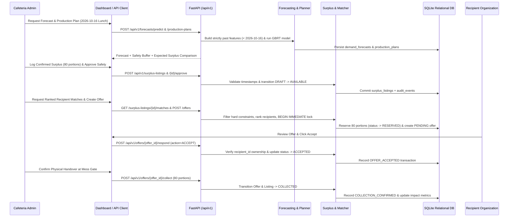

# System Architecture (`docs/architecture.md`)

## 1. Layered Architectural Design

The **AI-Powered Food Waste Prediction and Redistribution Intelligence** platform is organized into nine strictly decoupled logical layers:

1. **Presentation Layer (`app/` + Interactive Canvas App)**:
   - Multi-page Streamlit application (`Home.py` and `pages/1_Demand_Forecasting.py` through `6_Data_Management.py`) styled with a high-contrast environmental-technology palette (`#14532d` forest green, `#0f766e` teal).
   - Communicates exclusively with backend services via `app/services/api_client.py` (`BackendAPIClient`), preventing business-logic duplication in the UI.
2. **REST API & Input Validation Layer (`backend/api/routes.py`, `backend/schemas/models.py`)**:
   - FastAPI endpoints under `/api/v1/*` with strict Pydantic field constraints, date regexes, cross-field validators (`meals_served <= meals_prepared`, `food_discarded_portions <= leftover_portions`), and consistent HTTP status codes (`200`, `201`, `400`, `401`, `403`, `404`, `409`, `429`).
3. **Security, Authentication & RBAC Layer (`backend/core/security.py`, `backend/dependencies/auth.py`)**:
   - Password hashing via `PBKDF2-HMAC-SHA256` (`200,000` iterations, unique 16-byte random salt per user).
   - Stateless HMAC-SHA256 signed Bearer tokens carrying `user_id`, `role`, `recipient_id`, and expiration timestamp.
   - Fine-grained permission enforcement (`require_permission(...)`) on every mutating and sensitive read endpoint, plusrecipient-ownership verification so a `recipient_org` account can only accept or collect offers addressed to its own `recipient_id`.
4. **Data Validation & Preprocessing Pipeline (`backend/ml/data_preprocessing.py`)**:
   - Safe CSV parsing with extension check, 10 MB size cap, formula-injection character stripping (`=+-@`), duplicate `(service_date, meal_type)` removal, impossible-quantity rejection, IQR outlier inspection, and right-censored demand detection.
5. **Machine-Learning Forecasting & Evaluation Engine (`backend/ml/feature_engineering.py`, `train_model.py`, `predict_demand.py`, `evaluation.py`, `model_registry.py`)**:
   - Chronological feature construction where row $t$ accesses only records with `service_date < t`.
   - Compares `SeasonalMovingAverageBaseline` against `HistGradientBoostingRegressor` / `NumpyGradientBoostedTreesRegressor` on held-out chronological splits.
6. **Intelligent Production Planning Engine (`backend/domain/production_planner.py`)**:
   - Combines user-configured `shortage_risk_tolerance` ($\alpha$) with cost-asymmetry critical fractile $\frac{c_{\text{shortage}}}{c_{\text{shortage}} + c_{\text{unit}}}$ and normal residual quantile buffers, capped at `production_capacity`.
7. **Food Safety & Surplus State Machine (`backend/domain/food_safety.py`, `backend/domain/surplus_detector.py`)**:
   - Enforces chronological ordering (`preparation_time <= available_from_time < pickup_deadline <= safe_use_deadline`) and human safety approval before any listing becomes `AVAILABLE`.
   - Uses atomic `BEGIN IMMEDIATE` database transactions and process-level locks to prevent overbooking and race conditions.
8. **Recipient Matching & Ranking Engine (`backend/domain/recipient_matcher.py`)**:
   - Applies hard eligibility filters (active, verified, category acceptance, minimum capacity, >=30 min pickup window overlap, non-expired listing) and ranks eligible recipients using normalized weights (`0.30` proximity, `0.25` capacity fit, `0.25` urgency window, `0.20` priority tier).
9. **Relational Persistence & Audit Layer (`backend/database/models.py`, `session.py`, `migrations/`)**:
   - 12 normalized tables with foreign keys, check constraints, unique indexes, and an immutable `audit_events` + `redistribution_transactions` ledger.

## 2. Component Interaction Diagram

